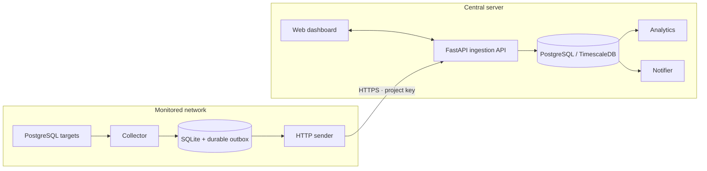

<div align="center">
  
  <h1>PGWarden</h1>
  <p><strong>PostgreSQL observability, schema intelligence, and alerting.</strong></p>
  <p>A self-hosted workspace to monitor your fleet, investigate workloads, and track schema changes.</p>
  <p>
    <a href="#quick-start">Quick start</a> ·
    <a href="#remote-collection">Remote collection</a> ·
    <a href="#configuration">Configuration</a> ·
    <a href="#documentation">Documentation</a>
  </p>
</div>


<p align="center"><em>Dashboard preview: database health, workload visibility, and schema inventory in one place.</em></p>

## What you can do

| Area | Capabilities |
| --- | --- |
| Fleet monitoring | Centralize multiple PostgreSQL servers and databases, including remote collectors. |
| Workload investigation | Inspect active queries, sessions, locks, connections, and transaction activity. |
| Database health | Follow table and index statistics, vacuum signals, growth, and historical metrics. |
| Schema intelligence | Explore tables, columns, indexes, relationships, and schema change history. |
| Alerting | Configure rules with Slack, Discord, Microsoft Teams, and SMTP email delivery. |
| Access control | Manage users, roles, project access, and ingestion keys from the dashboard. |

## Architecture

Deploy everything together, or keep collectors near your databases and send events to a central server over HTTP.



The **collector** polls PostgreSQL and persists observations locally. The **sender** (`collector/sender.py`) reads committed events from the SQLite outbox and delivers them to the remote API. The **central server** receives those events, stores them in TimescaleDB, and serves the dashboard, analytics, and alerts.

| Deployment | Services | Storage | Compose file |
| --- | --- | --- | --- |
| `full` | Dashboard, API, collector, analytics, notifier, migrations, database | Central TimescaleDB | [`docker-compose.yaml`](docker-compose.yaml) |
| `server` | Dashboard, receiving API, analytics, notifier, migrations, database | Central TimescaleDB | [`docker/docker-compose.server.yaml`](docker/docker-compose.server.yaml) |
| `collector` | Collector, outgoing sender, migrations, sender initialization | Local SQLite volume | [`docker/docker-compose.collector-sqlite.yaml`](docker/docker-compose.collector-sqlite.yaml) |

Choose `full` for an installation with a central collector. Choose `server` plus one or more separate `collector` deployments for distributed collection. Each Compose file is standalone.

## Quick start

Requires Git, Docker Engine, and Docker Compose v2. Run the installer commands in Bash on Linux, macOS, or WSL with access to Docker.

```bash
git clone https://github.com/pedrohgoncalvess/pgwarden.git
cd pgwarden
bash scripts/start-full.sh --configure-only
```

The installer creates `.env` with random encryption, JWT, database, and administrator secrets, plus `config.local.yaml` with matching database credentials. Review these files, add your PostgreSQL targets to `config.local.yaml`, then start:

```bash
bash scripts/start-full.sh
```

- **Dashboard:** [http://localhost:3000](http://localhost:3000)
- **API documentation:** [http://localhost:8080/docs](http://localhost:8080/docs)
- **Sign in:** use `PGWARDEN_EMAIL` and `PGWARDEN_PASSWORD` from `.env`.

Existing configuration is preserved. The installer does not pull changes or switch branches automatically. With an existing `.env`, review credentials and the collector config yourself. Retain the environment files, encryption keys, and Docker volumes across restarts.

All shortcuts use [`scripts/install.sh`](scripts/install.sh). It also accepts `--dir <path>`, `--repo <url>`, `--ref <branch-or-tag>`, and `--name <compose-project-name>`. Secret generation uses a temporary Python Docker container; local Python is not required.

## Remote collection

### 1. Start the central server

On the receiving machine, from a checkout:

```bash
bash scripts/start-server.sh --configure-only
# Review .env, including administrator credentials and ports.
bash scripts/start-server.sh
```

Open the dashboard, sign in with the administrator credentials in `.env`, then create a project in **Settings → Projects**. Copy its ingestion key for the remote collector.

The central stack runs without a collector. Its database is internal to the Docker network, and services connect to `db:5432`. Expose the receiving API through HTTPS for remote delivery.

### 2. Configure the remote collector and sender

On a machine that can reach the monitored PostgreSQL targets, from another checkout:

```bash
bash scripts/start-collector.sh --configure-only
```

Edit the generated `.env.sqlite`:

```dotenv
# Keep the ENCRYPTION_KEY generated by the installer.
COLLECTOR_STORAGE_BACKEND=sqlite
COLLECTOR_SQLITE_PATH=/var/lib/pgwarden/collector.sqlite3

# Full API endpoint, including the path.
SENDER_URL=https://warden.example.com/v1/ingestion/events
SENDER_PROJECT_KEY=pgw_replace-with-your-project-ingestion-key
SENDER_INTERVAL=5
SENDER_BATCH_SIZE=250
SENDER_TIMEOUT=30
```

Edit the generated `config.sqlite.yaml` with your PostgreSQL targets. The [configuration example below](#collector-targets-and-schedules) shows target credentials, filters, and collection intervals.

```bash
bash scripts/start-collector.sh
```

The deployment applies SQLite migrations, initializes event capture, and starts the collector and sender. Both share the `collector_sqlite` volume. The sender makes outbound requests and exposes no inbound port; it does not need direct access to the central database.

### 3. Verify delivery

```bash
# On the collector machine:
docker compose --env-file .env.sqlite -p pgwarden-local -f docker/docker-compose.collector-sqlite.yaml ps
docker compose --env-file .env.sqlite -p pgwarden-local -f docker/docker-compose.collector-sqlite.yaml logs -f collector sender

# On the central server:
docker compose --env-file .env -p pgwarden -f docker/docker-compose.server.yaml logs -f api
```

Look for `Acknowledged ... events` in sender logs and check the imported servers and metrics in the dashboard. The API identifies them as remotely collected, so a central collector will not poll those targets again.

### Delivery and persistence

- SQLite triggers capture immutable metadata and metric events in the same transaction as the collected data. Server connection credentials are excluded from delivery.
- The sender preserves event IDs and ordering across retries. The receiving API deduplicates retries and acknowledges accepted events.
- The sender removes a batch only after complete acknowledgement. Network failures retain queued events and retry with bounded backoff.
- Automatically rotated project keys are encrypted and persisted with the acknowledgement. A persisted key takes precedence over the original environment value.
- Collected rows remain in SQLite after delivery. Local metrics and central ingestion receipts have no automatic retention yet; monitor disk usage.

Run one collector and one sender per SQLite file. Preserve the SQLite volume and its `ENCRYPTION_KEY` together. Use a fresh volume when changing ingestion projects. See the [collector operations guide](collector/README.MD) for backup considerations, native setup, upgrades, and key recovery.

## Configuration

### Configuration files

| File | Purpose |
| --- | --- |
| [`.env.example`](.env.example) → `.env` | Central database, encryption, JWT, administrator credentials, and ports. |
| [`config.yaml`](config.yaml) / generated `config.local.yaml` | Full-stack PostgreSQL targets, collection settings, and notifier bootstrap. `PGWARDEN_CONFIG_FILE` selects the full-stack file. |
| [`docker/.env.collector.example`](docker/.env.collector.example) → `.env.sqlite` | Remote SQLite storage, encryption, and HTTP delivery settings. |
| [`collector/config.sqlite.example.yaml`](collector/config.sqlite.example.yaml) → `config.sqlite.yaml` | Remote PostgreSQL targets and collection schedules. |
| [`presets.collector.yaml`](presets.collector.yaml) | Example default, conservative, and aggressive collection schedules. |
| [`analytics/config.yaml`](analytics/config.yaml) | Central analytics settings. |

The server-only Compose reads notifier settings from `config.yaml`. API, analytics, and notifier always use central PostgreSQL; SQLite is an opt-in backend for a separate collector and its migrations.

### Collector targets and schedules

```yaml
servers:
  - name: production-postgres
    host: postgres.internal
    port: 5432
    username: pgwarden_monitor
    password: replace-with-monitor-password
    ssl_mode: require
    server_metrics_enabled: false
    databases:
      - app
    ignore_patterns:
      - "^_timescale.*"
      - "^pg_.*"
    # Optional table filters:
    # ignore_tables: [public.audit_log]
    # include_tables: [public.orders, public.customers]

# Global overrides; intervals are in seconds.
collector:
  database_stat_collector:
    interval: 3
    enabled: true
  native_query_collector:
    interval: 0.5
    enabled: true
  table_metric_collector:
    interval: 1800
    enabled: true
```

Configure the `collector` block at the YAML root. Unspecified collectors retain their built-in defaults. Restart the collector after changing the file or adding targets so bootstrap and collection loops use the updated settings.

**System metrics describe the collector's machine or container.** Leave `server_metrics_enabled: false` when polling PostgreSQL on another host. Enable it only when the collector's runtime represents the host you intend to measure.

| Collection | Default interval |
| --- | --- |
| Tables, columns, indexes and their statistics | 1,800 seconds |
| Database statistics, locks, sessions | 3 seconds |
| Active queries (`native_query_collector`) | 0.5 seconds |
| CPU / RAM | 20 seconds |
| I/O | 5 seconds |
| Disk | 1,800 seconds |

Use a dedicated monitoring account with access to the required PostgreSQL statistics views, such as through `pg_monitor`, and connectivity to each configured database. Keep target credentials in local configuration; do not commit them. Retain `ENCRYPTION_KEY`, which protects stored credentials.

### Sender settings

| Variable | Default | Description |
| --- | --- | --- |
| `ENCRYPTION_KEY` | Required | Fernet key protecting local credentials and the persisted project key. |
| `COLLECTOR_STORAGE_BACKEND` | `postgresql` | Set to `sqlite` for the remote collector; the remote Compose enforces this. |
| `COLLECTOR_SQLITE_PATH` | Explicit in remote deployment | Persistent SQLite file shared by migrations, collector, and sender. Remote Compose mounts `/var/lib/pgwarden/collector.sqlite3`. |
| `SENDER_URL` | Required | Full receiving URL: `https://<host>/v1/ingestion/events`. |
| `SENDER_PROJECT_KEY` | Required on initialization | Project ingestion key from the central dashboard. |
| `SENDER_INTERVAL` | `5` | Idle polling interval in seconds; must be positive. Pending successful batches drain immediately. |
| `SENDER_BATCH_SIZE` | `250` | Events per batch, from 1 to 500; requests are also limited to 2 MiB. |
| `SENDER_TIMEOUT` | `30` | HTTP request timeout in seconds; must be positive. |

For manual setup, copy the example files and replace all placeholders, including encryption keys and administrator credentials. The [collector guide](collector/README.MD#manual-docker-deployment) covers manual Docker startup. The [ingestion protocol](docs/remote-ingestion.md) documents payloads, key rotation, limits, and response codes.

## Operations

Use the same environment file, Compose file, and project name for every command so the deployment keeps using its existing volumes. Installer defaults are `pgwarden` for full/server and `pgwarden-local` for collector.

```bash
# Full stack: status, logs, and shutdown while preserving volumes.
docker compose --env-file .env -p pgwarden ps
docker compose --env-file .env -p pgwarden logs -f
docker compose --env-file .env -p pgwarden down

# Central server:
docker compose --env-file .env -p pgwarden -f docker/docker-compose.server.yaml ps

# Remote collector:
docker compose --env-file .env.sqlite -p pgwarden-local -f docker/docker-compose.collector-sqlite.yaml ps
```

| Symptom | What to check |
| --- | --- |
| Collector cannot connect | PostgreSQL host, port, credentials, TLS mode, firewall, and database access. |
| Sender receives `401` | Expired or revoked project key. Follow [persisted-key recovery](collector/README.MD#http-sender); changing `.env.sqlite` alone does not replace it. |
| Sender receives `409` / `422` | Missing dependencies, conflicting events, or invalid rows. The failed batch stays queued; inspect sender/API logs. |
| No system metrics | `server_metrics_enabled` and whether the collector runs on the intended host. |
| SQLite volume keeps growing | Retained local metrics and pending outbox events during delivery failures. |

## Documentation

- [Collector and HTTP sender](collector/README.MD) — SQLite storage, manual/native installation, key recovery, and deployment limits.
- [Remote ingestion protocol](docs/remote-ingestion.md) — projects, key lifecycle, event format, ordering, and acknowledgements.
- [Users, roles, and access control](docs/access-control.md) — resource grants, capabilities, and account management.
- [Notifier](notifier/README.md) and [analytics](analytics/README.md) — service documentation.
- [CI and releases](.github/README.md) — validation, version tags, and image publication.

## Contributing

Bug reports, feature proposals, and focused pull requests are welcome. Run the relevant checks locally; [`run_tests.sh`](run_tests.sh) runs the repository suite with a disposable PostgreSQL test environment. Update documentation when changing configuration or deployment behavior, and keep credentials and generated local data out of commits.

## License

PGWarden is source-available under the [PolyForm Noncommercial License 1.0.0](LICENSE). Non-commercial use, modification, and sharing are permitted under its terms. Commercial use requires separate permission from the copyright holder.
